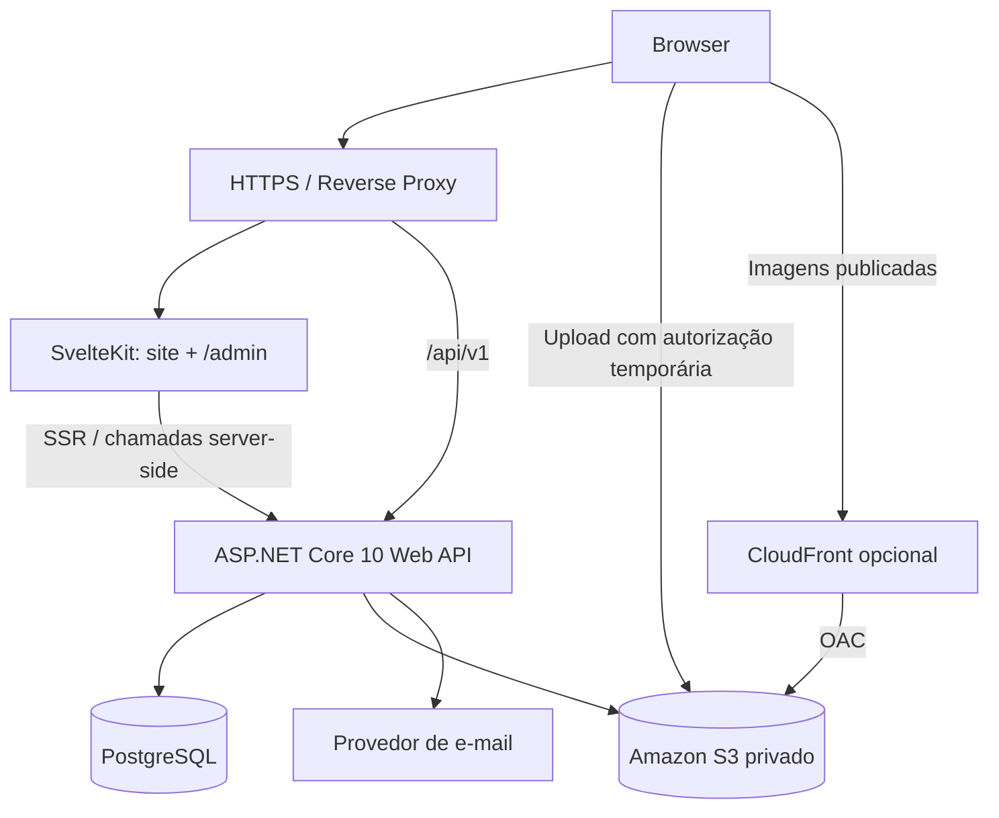
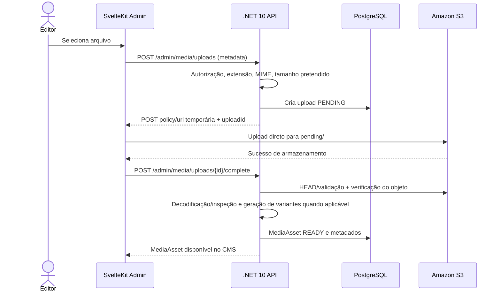

# Blueprint do Projeto — Website Premium + CMS Administrativo

> **Documento-base para discovery, specs, planos, checklists, implementação e validação.**
> **Referência de experiência:** https://blaiter.vercel.app/  
> **Stack mandatória:** Svelte 5 / SvelteKit + TypeScript (frontend); ASP.NET Core Web API em .NET 10 / C# (backend); PostgreSQL (dados); **Amazon S3 (mídias)**.  
> **Versão:** 1.0.0 — 12/11/2026.  
> **Estado:** decisões arquiteturais consolidadas; funcionalidades e estética detalhadas devem ser refinadas em specs.

## Sumário

1. [Objetivo e princípios](#1-objetivo-e-princípios)
2. [Decisões consolidadas e pendências](#2-decisões-consolidadas-e-pendências)
3. [Stack completa e responsabilidades](#3-stack-completa-e-responsabilidades)
4. [Arquitetura e fluxos](#4-arquitetura-e-fluxos)
5. [Escopo funcional](#5-escopo-funcional)
6. [Design, animações e responsividade](#6-design-animações-e-responsividade)
7. [Modelo de domínio e dados](#7-modelo-de-domínio-e-dados)
8. [Contrato e padrões da API](#8-contrato-e-padrões-da-api)
9. [Autenticação, autorização e segurança](#9-autenticação-autorização-e-segurança)
10. [Amazon S3: arquitetura de mídias](#10-amazon-s3-arquitetura-de-mídias)
11. [SEO, acessibilidade, performance e observabilidade](#11-seo-acessibilidade-performance-e-observabilidade)
12. [Desenvolvimento, testes, CI/CD e deploy](#12-desenvolvimento-testes-cicd-e-deploy)
13. [Roadmap por fases e dependências](#13-roadmap-por-fases-e-dependências)
14. [Backlog inicial de specs](#14-backlog-inicial-de-specs)
15. [Template de spec, plano e checklist](#15-template-de-spec-plano-e-checklist)
16. [Critérios de aceite globais e Definition of Done](#16-critérios-de-aceite-globais-e-definition-of-done)
17. [Prompt-mestre atualizado para implementação assistida](#17-prompt-mestre-atualizado-para-implementação-assistida)
18. [Riscos, limites e perguntas de refinamento](#18-riscos-limites-e-perguntas-de-refinamento)
19. [Referências oficiais](#19-referências-oficiais)

---

## 1. Objetivo e princípios

### 1.1 Visão

Construir um website de apresentação de marca, categorias, coleções e lookbooks, com experiência editorial premium **inspirada no design e nas animações da referência**. O website deve ser gerenciado por um CMS próprio, acessível em `/admin`, para que os proprietários editem banners, categorias, menus, lookbooks, páginas, mídias, configurações e usuários **sem alterar código nem realizar novo deploy**.

A solução será composta por:

- **Website público:** experiência visual, navegação, conteúdo dinâmico e SEO.
- **Painel administrativo:** gestão de conteúdo, publicação, permissões, mídias e auditoria.
- **API backend:** fonte única das regras de negócio, autenticação, autorização, validações e persistência.
- **Infraestrutura:** PostgreSQL para dados relacionais, Amazon S3 para objetos e serviços operacionais mínimos.

### 1.2 Princípios de engenharia

1. **Fidelidade à referência sem suposições:** analisar o site real em desktop e mobile antes de especificar animações; registrar o que foi observado. A extração textual da página revela a seção “Lookbook”, mas não é suficiente para afirmar detalhes de animação, tipografia ou layout.
2. **Fonte de verdade centralizada:** a API .NET é responsável por regras, validações, permissões, transações e publicação. O SvelteKit cuida de experiência e renderização.
3. **Monólito modular primeiro:** não criar microsserviços, mensageria ou event bus sem necessidade demonstrada.
4. **Conteúdo 100% dinâmico onde gerenciável:** evitar hardcode para menus, banners, categorias, lookbooks e páginas.
5. **Segurança por padrão:** autorização no backend, objetos privados no S3, validação de uploads, cookies seguros e trilha de auditoria.
6. **Progressividade:** começar com módulos essenciais e evoluir por specs pequenas, verificáveis e testáveis.
7. **Acessibilidade e desempenho como requisitos:** animações não podem impedir navegação, uso de teclado ou dispositivos com movimento reduzido.
8. **Direitos de uso:** reproduzir a linguagem visual e os comportamentos observáveis; utilizar apenas imagens, logotipos, textos e demais materiais cujo uso seja autorizado.

### 1.3 Fora do escopo inicial (salvo decisão futura)

- Checkout, carrinho, pagamentos, frete, cupons e gestão de pedidos.
- ERP, marketplace ou gestão complexa de estoque.
- Multi-tenant para múltiplas empresas com isolamento de dados (a primeira versão gerencia **um site/marca**, com múltiplos usuários administrativos).
- Aplicativos mobile nativos.
- Editor visual irrestrito tipo Webflow; usar **blocos estruturados**.
- Microsserviços, Kubernetes, SQS/SNS e arquitetura orientada a eventos distribuídos.

> Caso o projeto evolua para e-commerce, criar specs próprias de produtos, preço, estoque, carrinho, checkout e integrações de pagamento. Não inferir que essas funcionalidades já estão autorizadas.

---

## 2. Decisões consolidadas e pendências

### 2.1 ADRs resumidas — decisões tomadas

| ID | Decisão | Motivo / consequência |
|---|---|---|
| ADR-001 | Svelte 5 + SvelteKit + TypeScript no frontend | SSR, roteamento, UI reativa e menor sobrecarga para experiência editorial. |
| ADR-002 | ASP.NET Core Web API em **.NET 10 LTS** | API tipada, robusta, com autenticação e autorização centralizadas. |
| ADR-003 | PostgreSQL + EF Core 10 + Npgsql | Persistência relacional e migrations. |
| ADR-004 | **Amazon S3**, não Cloudflare R2 | Armazenamento de imagens, banners, vídeos e demais arquivos. |
| ADR-005 | Monólito modular, com projetos Api/Application/Domain/Infrastructure | Separação de responsabilidades sem distribuição prematura. |
| ADR-006 | Um frontend SvelteKit para público e `/admin` | Reuso de componentes, infraestrutura e identidade visual. |
| ADR-007 | REST JSON com OpenAPI, versionamento `/api/v1` | Contrato documentado e cliente TypeScript gerado. |
| ADR-008 | ASP.NET Core Identity + RBAC/policies | Gerenciamento de usuários e autorização por operação. |
| ADR-009 | GSAP + ScrollTrigger; Svelte transitions para efeitos simples | Controle preciso das animações e redução de conflito entre motores. |
| ADR-010 | Tailwind CSS 4 + shadcn-svelte/Bits UI | Design system customizado e painel acessível. |
| ADR-011 | Publicação com rascunho, prévia e estado publicado | Edição sem tornar alterações imediatamente públicas. |
| ADR-012 | Docker + GitHub Actions | Reprodutibilidade e automação de qualidade/deploy. |
| ADR-013 | S3 privado + URLs temporárias de upload + CDN opcional | Reduz exposição de credenciais e tráfego através da API. |
| ADR-014 | Sem Redis obrigatório no MVP | Cache local/HTTP primeiro; adicionar Redis após necessidade mensurada. |

### 2.2 Defaults propostos (a ratificar em specs de infraestrutura)

- **Origem única em produção**, preferencialmente `https://dominio.com` para SvelteKit e `https://dominio.com/api/*` para a API por proxy reverso. Simplifica cookies, SSR e política de origem.
- **Sessões com cookie HttpOnly/Secure/SameSite e autenticação ASP.NET Core Identity**, não usar JWT em `localStorage` para o navegador. Um BFF dedicado só será necessário se a topologia de deploy exigir múltiplas origens.
- **SvelteKit com SSR** nas páginas públicas e cargas server-side de dados; `/admin` protegido e sem indexação.
- **S3 privado por padrão**, entrega das mídias públicas via CloudFront com Origin Access Control (OAC) se houver CDN em produção; usar URLs assinadas para conteúdos privados.
- **Publicação explícita** de rascunhos, com invalidação de cache e propagação sem rebuild do frontend.
- **Armazenamento de arquivos no S3 e metadados no PostgreSQL.**
- **Desenvolvimento local:** Docker Compose, PostgreSQL, Mailpit e emulador S3 compatível (ex.: MinIO); produção usa Amazon S3 real.

### 2.3 Pontos pendentes, sem bloquear o início

1. Nome/branding definitivo, domínio, logotipos e acervo de fotos autorizado.
2. Auditoria visual real da referência: screenshots, mapas de seções, breakpoints, duração/easing das animações.
3. Catálogo de conteúdos exato: lookbooks, coleções e categorias; se existirá produto sem checkout.
4. Limites de upload e formatos aceitos, incluindo necessidade real de vídeo.
5. Provedor de hospedagem do frontend/API, região AWS e orçamento.
6. Política de retenção de auditoria, privacidade/LGPD, e-mails e backups.
7. Se os editores podem publicar diretamente ou apenas preparar rascunhos (default: permissão separada).

---

## 3. Stack completa e responsabilidades

### 3.1 Frontend (mandatório e preferencial)

| Camada | Tecnologia | Adoção | Responsabilidade |
|---|---|---|---|
| UI | **Svelte 5** | Obrigatória | Componentes e reatividade. |
| Framework | **SvelteKit** | Obrigatória | Roteamento, SSR, layouts e server load. |
| Linguagem | **TypeScript** | Obrigatória | Tipagem. |
| Tooling | Vite | Padrão SvelteKit | Build e HMR. |
| CSS | **Tailwind CSS 4** | Preferencial | Estilos utilitários e tokens. |
| UI admin | **shadcn-svelte + Bits UI** | Preferencial | Componentes customizáveis e acessíveis. |
| Ícones | Lucide Svelte | Preferencial | Ícones consistentes. |
| Animação | **GSAP + ScrollTrigger** | Preferencial | Timelines, scroll, reveals, transições editoriais. |
| Animação leve | Svelte transitions/CSS | Preferencial | Modais, dropdowns, fades simples. |
| Smooth scroll | Lenis | Condicional | Aplicar somente se reproduzir referência e não prejudicar UX. |
| Estado | Svelte 5 runes | Padrão | Estado local. |
| Server state | TanStack Query para Svelte | Condicional | Cache e mutações do admin em interfaces client-heavy. |
| Formulários | Superforms + Zod | Preferencial | UX e validações frontend; backend continua autoritativo. |
| Tabelas | TanStack Table | Preferencial | Listagens admin, paginação e ordenação. |
| Drag-and-drop | SortableJS ou alternativa acessível | Preferencial | Reordenação de menus, banners e blocos. |
| Rich text | Tiptap com integração adequada ao Svelte | Condicional | Conteúdo editorial sanitizado. |
| Gráficos | ECharts | Condicional | Dashboard apenas com métricas reais. |
| API client | openapi-typescript + openapi-fetch (ou equivalente) | Preferencial | Tipos/clientes gerados a partir do OpenAPI do .NET. |

**Observação:** verificar compatibilidade e licenças das versões exatas no momento de abrir a spec de implementação. **Não empilhar bibliotecas redundantes** (por exemplo, múltiplos motores de animação sem necessidade).

### 3.2 Backend

| Camada | Tecnologia | Adoção | Responsabilidade |
|---|---|---|---|
| Linguagem/runtime | **C# / .NET 10 LTS** | Obrigatória | Plataforma backend. |
| API | **ASP.NET Core Web API** | Obrigatória | HTTP REST. |
| ORM | **EF Core 10** | Obrigatória | Mapeamento, migrations e transações. |
| Driver | **Npgsql** | Obrigatória | PostgreSQL para .NET. |
| Banco | **PostgreSQL** | Obrigatória | Dados transacionais. |
| Identidade | **ASP.NET Core Identity** | Obrigatória | Usuários, senhas, recuperação, sessões. |
| Autorização | Policies + RBAC | Obrigatória | Verificação por ação/recurso. |
| Validação | FluentValidation ou validação nativa centralizada | Preferencial | Contratos de entrada. |
| DTO mapping | Mapster ou mapeamento explícito | Opcional | Conversão camada HTTP/domínio. |
| Logs | Serilog | Preferencial | Logs estruturados. |
| API docs | ASP.NET Core OpenAPI + Scalar UI | Preferencial | Contratos e exploração em dev. |
| Rate limiting | RateLimiter nativo do ASP.NET Core | Preferencial | Proteção de login e endpoints críticos. |
| Telemetria | OpenTelemetry | Preferencial | Traces/métricas. |
| Cache | OutputCache / MemoryCache | Inicial | Cache de consultas públicas. |
| Cache distribuído | Redis | Futuro/condicional | Só com necessidade de múltiplas instâncias ou escala. |
| Storage SDK | **AWSSDK.S3** (SDK for .NET) | Obrigatória | Presign, metadata e operação de objetos. |
| Imagens | ImageSharp ou alternativa compatível | Condicional | Variantes de tamanho; validar licenciamento. |
| E-mail | Resend ou provedor SMTP transacional | Preferencial | Convites e recuperação de senha. |

### 3.3 Infraestrutura, CI e qualidade

| Tecnologia | Adoção | Finalidade |
|---|---|---|
| **Amazon S3** | Obrigatória | Bucket de mídias, objetos privados e publicação. |
| AWS IAM | Obrigatória | Roles com privilégio mínimo. |
| Amazon CloudFront + OAC | Recomendado em produção | CDN das mídias publicadas sem bucket público. |
| Docker / Compose | Obrigatória | Ambientes locais e builds reproduzíveis. |
| Caddy ou Nginx | Recomendado | HTTPS e roteamento por origem única. |
| GitHub Actions | Recomendado | Pipeline CI/CD. |
| Vitest | Recomendado | Testes unitários frontend. |
| Playwright + axe-core | Recomendado | E2E, regressão visual e acessibilidade automatizada. |
| xUnit | Recomendado | Testes unitários backend. |
| WebApplicationFactory | Recomendado | Teste de API. |
| Testcontainers for .NET | Recomendado | Integração com PostgreSQL isolado. |
| Sentry (ou equivalente) | Opcional | Erros frontend/backend. |
| AWS CloudWatch ou stack de logs equivalente | Condicional | Observabilidade em hospedagem AWS. |

---

## 4. Arquitetura e fluxos

### 4.1 Diagrama lógico



> A topologia definitiva de publicação será detalhada em `SPEC-015-INFRA`. Em desenvolvimento, usar proxy para manter comportamento equivalente ao da produção.

### 4.2 Separação de responsabilidades

**SvelteKit**
- Renderizar páginas públicas com SSR, SEO, acessibilidade e animações.
- Renderizar admin com proteção de rota e controles de interface.
- Carregar dados publicados para páginas públicas e dados administrativos autenticados para admin.
- Gerir estados de formulário, visualização e feedback.
- **Não** implementar regras de negócio/persistência duplicadas; cargas server-side podem atuar como proxy/BFF fino se necessário.

**API .NET**
- Autenticação, autorização, validações e regras de domínio.
- CRUD e gerenciamento de conteúdo.
- Upload autorizado, confirmação, validação e gerenciamento de mídias S3.
- Fluxos de rascunho, prévia, publicação, versionamento e auditoria.
- Consultas públicas eficientes e contratos OpenAPI.

**PostgreSQL**
- Usuários, permissões, banners, menus, categorias, páginas, blocos, mídias, coleções, lookbooks, configurações, versões e auditoria.

**Amazon S3**
- Armazenar os bytes dos arquivos e suas variantes.
- Não armazenar regras de negócio nem metadados relacionais como única fonte da verdade.

### 4.3 Fluxo de leitura pública

1. Navegador solicita uma página no SvelteKit.
2. `+page.server.ts`/`+layout.server.ts` consulta endpoints públicos da API, com contrato tipado.
3. API lê somente conteúdos **publicados/visíveis**, aplica cache adequado e devolve JSON.
4. SvelteKit entrega HTML SSR e hidrata interações progressivamente.
5. Mídias são carregadas de URL pública de CDN autorizada, com tamanhos responsivos e lazy loading.

### 4.4 Fluxo de edição e publicação

1. Administrador autenticado abre `/admin`.
2. API valida sessão e policies por operação.
3. Editor cria/atualiza **rascunho**; API valida e grava com controle otimista de concorrência.
4. Editor visualiza **preview privado** com token/identidade autorizada; preview nunca entra no cache público.
5. Usuário autorizado executa `publish`.
6. API atualiza versão publicada em transação, grava auditoria e invalida caches relevantes.
7. Website passa a consultar conteúdo publicado sem exigir rebuild/deploy.

### 4.5 Estratégia de cache

- Não fazer prerender estático de páginas gerenciadas que dependam de publicação imediata, salvo estratégia explícita de rebuild/revalidation.
- Cachear consultas públicas com tags/chaves que possam ser invalidadas, ou TTL curto documentado.
- SSR do SvelteKit deve seguir o contrato de cache definido; evitar servir HTML antigo após edição publicada.
- Meta inicial: nova publicação visível para visitantes em **até 60 segundos** sob condições normais, com teste de integração. Pode ser menor quando houver invalidação explícita.
- Admin, sessões e preview: `Cache-Control: private, no-store`.

---

## 5. Escopo funcional

Identificadores `FR-*` são base para refinamento e rastreabilidade.

### 5.1 Site público

| ID | Requisito | Prioridade |
|---|---|---|
| FR-PUB-001 | Home dinâmica estruturada em blocos reutilizáveis e ordenáveis. | MVP |
| FR-PUB-002 | Header, logo e menu/submenus vindos do CMS. | MVP |
| FR-PUB-003 | Hero/banners responsivos com imagem desktop/mobile, título, CTA e controle de publicação. | MVP |
| FR-PUB-004 | Listagem e páginas de categorias com SEO e mídia. | MVP |
| FR-PUB-005 | Listagem, detalhe e galeria de lookbooks. | MVP |
| FR-PUB-006 | Páginas editoriais/institucionais dinâmicas. | MVP |
| FR-PUB-007 | Footer e redes sociais configuráveis. | MVP |
| FR-PUB-008 | Transições e animações alinhadas à auditoria da referência. | MVP |
| FR-PUB-009 | Imagens responsivas, acessibilidade, SEO e boa performance. | MVP |
| FR-PUB-010 | Seções adicionais com novos tipos de bloco. | P2 |

### 5.2 CMS — dashboard e conteúdo

| ID | Requisito | Prioridade |
|---|---|---|
| FR-ADM-001 | Dashboard com métricas reais e atalhos. | MVP |
| FR-ADM-002 | CRUD de banners, upload, status, ordenação e versões mobile/desktop. | MVP |
| FR-ADM-003 | CRUD de categorias, slug, imagem, hierarquia opcional e ordenação. | MVP |
| FR-ADM-004 | Gerenciador de menus, itens, submenus, destinos e ordenação. | MVP |
| FR-ADM-005 | CRUD de lookbooks, coleções e galerias ordenáveis. | MVP |
| FR-ADM-006 | Gerenciador de páginas com blocos tipados e configuração. | MVP |
| FR-ADM-007 | Biblioteca central de mídias e seleção de arquivos existentes. | MVP |
| FR-ADM-008 | Configurações do site: identidade, footer, contato e SEO. | MVP |
| FR-ADM-009 | Rascunho, preview autenticado, publicação e despublicação. | MVP |
| FR-ADM-010 | Busca, filtros, paginação e estados vazio/carregando/erro. | MVP |
| FR-ADM-011 | Histórico de revisões, diff e restauração de conteúdo. | P2 |
| FR-ADM-012 | Agendamento de banners e conteúdo por data. | P2 |

### 5.3 Usuários e segurança

| ID | Requisito | Prioridade |
|---|---|---|
| FR-ID-001 | Login/logout, sessão segura, recuperação e troca de senha. | MVP |
| FR-ID-002 | Usuários: convite, edição, ativação/desativação e revogação de sessão. | MVP |
| FR-ID-003 | Papéis SUPER_ADMIN, ADMIN, EDITOR, VIEWER. | MVP |
| FR-ID-004 | Permissões por ação/recurso aplicadas na API. | MVP |
| FR-ID-005 | Trilha de auditoria de alterações e eventos sensíveis. | MVP |
| FR-ID-006 | Bootstrap seguro do primeiro SUPER_ADMIN, sem senha hardcoded. | MVP |
| FR-ID-007 | MFA para perfis administrativos sensíveis. | P2 recomendada |

### 5.4 Detalhes por conteúdo

**Banner**
- Identificador, título interno, tipo (imagem/vídeo quando habilitado), mídia desktop/mobile, título, subtítulo, descrição, CTA label/url, posição/alinhamento, overlay, ordem, página/slot de exibição, status e SEO/alt.
- Regras: CTA link validado; mídia necessária; não expor rascunho; agendamento é P2.

**Categoria**
- Nome, slug único, descrição, imagem, parent opcional, ordem, status, metadata SEO.
- Regras: impedir ciclo na hierarquia; slug estável e redirecionamento 301 quando alterado, conforme spec.

**Menu**
- Key/localização (`header`, `footer`, etc.), itens aninhados, rótulo, destino interno/externo, target, ativo e posição.
- Regras: prevenir ciclos; validar URLs; `rel="noopener noreferrer"` em links externos nova aba.

**Lookbook/Coleção**
- Título, slug, descrição, capa, lista de imagens ordenada, categorias associadas, tags, status e metadata SEO.
- Regras: imagem de capa, autorização de mídias, estados de publicação.

**Página**
- Slug, template, título, SEO, status, blocos `type + validated config`, ordem, versionamento.
- Tipos iniciais de bloco: hero, banner carousel, categories grid, image-with-text, editorial text, image gallery, lookbook grid, CTA, FAQ, video opcional.
- Regras: schemas discriminados por tipo de bloco, não criar construtor arbitrário de HTML/scripts.

**Mídia**
- Nome, key S3, tipo detectado, tamanho, largura/altura, formatos/variantes, hash/checksum, alt, origem, estado, referência de uso e timestamps.
- Regras: não excluir objeto que está em uso por conteúdo publicado; exclusão lógica/retention quando cabível.

---

## 6. Design, animações e responsividade

### 6.1 Auditoria da referência obrigatória antes da UI final

Criar `docs/reference-audit.md` com:

- Mapa de páginas e seções, arquitetura de navegação, screenshots completos (desktop/mobile/tablet quando possível).
- Cores, tipografias, grids, espaçamentos, proporções, recortes de imagens, breakpoints.
- Inventário de cada interação visível: evento, trigger, timeline, distância de scroll, duração, easing, delay e comportamento mobile.
- Comparativos visuais entre referência e implementação; registrar o que **não foi possível inspecionar**.
- Lista de elementos prioritários para fidelidade visual e observações de acessibilidade.

**Não declarar fidelidade pixel-perfect sem evidências visuais.** O objetivo é alta fidelidade perceptiva e comportamental, mantendo materiais próprios/autorizados.

### 6.2 Regras de implementação

- Definir tokens de design em CSS: tipografia, escala de espaçamento, cores, radii, z-index e ritmo de movimento.
- Utilizar GSAP/ScrollTrigger para timelines e scroll effects; transições Svelte/CSS para interações simples.
- Registrar e destruir timelines/listeners em `onMount`/teardown; não executar APIs de DOM durante SSR.
- Preferir `transform`/`opacity` em vez de animar propriedades de layout.
- Respeitar `prefers-reduced-motion`: conteúdo continua plenamente visível e funcional.
- Não bloquear interação por overlays/intro; garantir navegação por teclado, foco e leitores de tela.
- Usar Lenis apenas se necessário à referência e testar dispositivos touch, links âncora e acessibilidade.
- Imagens hero devem reservar espaço e priorizar LCP; galerias abaixo da dobra usam lazy loading.

### 6.3 Breakpoints e testes

- Desktop amplo (ex.: 1440px), notebook (1280px), tablet (768px) e mobile (390px / 360px) como viewports de teste, não como únicos breakpoints de layout.
- Verificar menu mobile, galerias, interação touch, orientação, textos longos, zoom 200% e `prefers-reduced-motion`.

---

## 7. Modelo de domínio e dados

### 7.1 Módulos propostos

- `Identity`: `User`, `Role`, `Permission`/policy, `UserSession`, `Invitation`, `PasswordReset` (Identity pode prover partes).
- `Site`: `SiteSettings`, `NavigationMenu`, `NavigationItem`, `FooterSettings`.
- `Content`: `Page`, `PageBlock`, `ContentRevision`, `Publication`.
- `Catalog`: `Category`, `Collection`, `Lookbook`, `LookbookImage`, associações.
- `Campaigns`: `Banner`, `BannerPlacement`/`BannerSlot`.
- `Media`: `MediaAsset`, `MediaVariant`, `MediaUsage`, `MediaUpload`.
- `Audit`: `AuditLog`.

### 7.2 Convenções

- IDs UUID para entidades principais (convencionar `Guid` com PostgreSQL `uuid`).
- `created_at`, `updated_at`, `created_by`, `updated_by` nas entidades administrativas.
- `slug` único por contexto (com constraint/índice adequado).
- `sort_order` para coleções ordenáveis; normalização/reindexação dentro de transação.
- Publicação explícita: campos/entidades que permitam separar conteúdo em rascunho do snapshot publicado.
- `row_version` ou concurrency token para impedir sobrescrita silenciosa de edições concorrentes.
- Soft delete onde necessário; política de retenção e limpeza de objetos; integridade referencial no banco.
- Índices para `slug`, `status`, `published_at`, `sort_order`, relacionamentos e filtros frequentes.
- JSONB somente para `PageBlock.config` e variantes polimórficas **com schemas validados e versionados**; dados relacionais continuam normalizados.
- Migrations EF Core versionadas no Git; não usar `EnsureCreated` em produção.

### 7.3 Estados e regras de publicação

Estados mínimos: `DRAFT`, `PUBLISHED`, `ARCHIVED` (ou modelo equivalente com draft e published version separadas).

- Publicar: validar conteúdo completo, mídia finalizada e permissão `content.publish`.
- Despublicar: retirar do público preservando histórico/auditoria.
- Preview: exibir draft somente para sessão autenticada com acesso; nunca permitir acesso por URL pública previsível.
- Conflito de edição: devolver HTTP 409 Conflict ou 412 Precondition Failed e permitir recarga/merge conforme spec.
- Exclusão: evitar apagar conteúdos referenciados sem análise de vínculos.

---

## 8. Contrato e padrões da API

### 8.1 Convenções HTTP

- Prefixo: `/api/v1`.
- REST com JSON e nomes consistentes; timestamps UTC ISO-8601.
- Erros no padrão **RFC 7807 / ProblemDetails** com `traceId` e mensagens seguras.
- Validação com respostas 400/422 conforme política escolhida, 401 para não autenticado, 403 para não autorizado, 404 para recurso não encontrado, 409 para conflito.
- Listas com paginação (`page`/`pageSize` ou cursor), filtros, busca e ordenação permitida via whitelist.
- Contrato OpenAPI gerado do código .NET; cliente TypeScript gerado como etapa do build/CI.
- Operações críticas idempotentes quando adequado; limites de tamanho no servidor.
- Endpoint de health separado (`/health/live`, `/health/ready`).

### 8.2 Superfícies HTTP iniciais (orientativas)

| Método | Endpoint | Autorização | Finalidade |
|---|---|---|---|
| GET | `/api/v1/public/site` | Pública | Configurações públicas, navegação e footer. |
| GET | `/api/v1/public/home` | Pública | Home e seções publicadas. |
| GET | `/api/v1/public/categories` | Pública | Listagem publicada. |
| GET | `/api/v1/public/categories/{slug}` | Pública | Detalhe publicado. |
| GET | `/api/v1/public/lookbooks` | Pública | Listagem publicada. |
| GET | `/api/v1/public/lookbooks/{slug}` | Pública | Detalhe publicado. |
| GET | `/api/v1/public/pages/{slug}` | Pública | Página publicada. |
| POST | `/api/v1/auth/login` | Anônima | Autenticar (rate-limited). |
| POST | `/api/v1/auth/logout` | Autenticada | Encerrar sessão. |
| GET | `/api/v1/auth/me` | Autenticada | Usuário e permissões efetivas. |
| GET/POST | `/api/v1/admin/banners` | `banner.read`/`banner.write` | Gestão de banners. |
| GET/PUT/DELETE | `/api/v1/admin/banners/{id}` | Policies específicas | Detalhar, editar, excluir. |
| POST | `/api/v1/admin/banners/{id}/publish` | `content.publish` | Publicar banner. |
| CRUD | `/api/v1/admin/categories/*` | Policies do módulo | Categorias. |
| CRUD | `/api/v1/admin/menus/*` | Policies do módulo | Menus e itens. |
| CRUD | `/api/v1/admin/lookbooks/*` | Policies do módulo | Lookbooks. |
| CRUD | `/api/v1/admin/collections/*` | Policies do módulo | Coleções. |
| CRUD | `/api/v1/admin/pages/*` | Policies do módulo | Páginas e blocos. |
| GET | `/api/v1/admin/pages/{id}/preview` | `page.read` | Preview privado e sem cache. |
| POST | `/api/v1/admin/pages/{id}/publish` | `content.publish` | Publicação transacional. |
| POST | `/api/v1/admin/media/uploads` | `media.write` | Criar sessão/POST policy temporária S3. |
| POST | `/api/v1/admin/media/uploads/{id}/complete` | `media.write` | Verificar e finalizar upload. |
| GET/DELETE | `/api/v1/admin/media/*` | Policies do módulo | Listar e remover mídias. |
| CRUD | `/api/v1/admin/users/*` | `user.manage` | Gestão de usuários. |
| GET/PUT | `/api/v1/admin/settings` | `settings.read/write` | Configurações. |
| GET | `/api/v1/admin/audit-logs` | `audit.read` | Histórico de auditoria. |

> `CRUD` é agrupamento ilustrativo, **não** método HTTP real. Cada spec definirá request/response, query params, status e políticas exatas.

### 8.3 Exemplos de critérios contratuais

- Todos os recursos da área admin exigem autenticação e policy.
- Public endpoints nunca retornam rascunhos, e-mails administrativos, chaves S3 ou dados privados.
- Reorder valida se todos os IDs pertencem ao escopo, evita IDs duplicados e grava atomicamente.
- Formulários frontend usam erros `ProblemDetails` para apresentar feedback por campo, sem revelar stack traces.
- Upload deve conferir os metadados e o objeto final antes de disponibilizar na biblioteca.

---

## 9. Autenticação, autorização e segurança

### 9.1 Modelo de sessão

**Default preferido:** site e API sob a mesma origem, com **ASP.NET Core Identity + cookie autenticado**:

- Cookie `HttpOnly`, `Secure`, `SameSite=Lax` (rever em integração externa), restrição de path/domínio adequada.
- Rotas de mutação protegidas com antiforgery/CSRF, validação de `Origin` quando pertinente e políticas CORS restritas.
- SvelteKit só obtém dados autorizados ao encaminhar a sessão ao backend para chamadas server-side estritamente à origem interna confiável; não encaminhar cookies indiscriminadamente a serviços externos.
- Autenticação autoritativa e verificação de permissões acontecem na API. Hooks de rota no SvelteKit melhoram UX, mas não substituem a autorização do backend.
- Sessões devem poder ser revogadas; limitar tentativas de login e registrar atividades sensíveis.

Se a implantação exigir frontend/API em origens distintas, abrir decisão específica para BFF e gerenciamento de sessão. **Não migrar automaticamente para JWT em localStorage.**

### 9.2 Papéis e capacidades

| Papel | Capacidades padrão |
|---|---|
| `SUPER_ADMIN` | Gestão integral, usuários, papéis, permissões, configurações críticas e auditoria. |
| `ADMIN` | Gestão do CMS e usuários conforme políticas explícitas; não pode elevar privilégios além dos próprios. |
| `EDITOR` | Criar/editar conteúdo autorizado; publicar somente com permissão específica. |
| `VIEWER` | Leitura de áreas autorizadas, sem alterações. |

Permissões de exemplo: `banner.read`, `banner.write`, `category.write`, `menu.write`, `lookbook.write`, `page.write`, `content.publish`, `media.write`, `user.manage`, `settings.write`, `audit.read`.

### 9.3 Medidas mínimas

- Hash seguro de senhas pelo Identity; sem senhas em logs/seed.
- Primeiro `SUPER_ADMIN` criado por bootstrap explícito via ambiente/command de provisionamento, não credenciais padrão previsíveis.
- Rate limiting para login, senha e presign; lockout/controlos contra brute force.
- Sanitização e restrição de HTML de editor rico, Content Security Policy e proteção XSS.
- Validação de URLs externas e tipos de arquivos; nenhuma chave AWS embutida no frontend.
- Segredos em secret manager/variáveis seguras; acesso AWS por IAM role em produção, evitando chaves estáticas.
- Auditoria de alterações, login anômalo, permissões, publicações e exclusões.
- Práticas LGPD: mínimo necessário, controle de acesso, retenção e processos de exclusão/exportação onde aplicável.
- Atualizações regulares de dependências e scanners de vulnerabilidade em CI.

---

## 10. Amazon S3: arquitetura de mídias

### 10.1 Decisão obrigatória

**Amazon Simple Storage Service (S3)** é o serviço oficial de armazenamento de mídia do projeto. Remover qualquer dependência de Cloudflare R2 da implementação anterior. **CloudFront** é opcional e recomendado para distribuição/CDN; não substitui o S3.

### 10.2 Buckets, caminhos e segurança

Configuração recomendada para produção:

- Bucket S3 privado, **Block Public Access habilitado**.
- Criptografia server-side (SSE-S3 ou SSE-KMS conforme necessidade).
- IAM com mínimo privilégio e roles da aplicação.
- Estrutura de chaves ilustrativa:

```text
media/
  pending/{uploadId}/{opaqueName}
  original/{mediaId}/{opaqueName}
  variants/{mediaId}/sm.webp
  variants/{mediaId}/md.webp
  variants/{mediaId}/lg.webp
  videos/{mediaId}/{opaqueName}
```

- Nunca usar nome original diretamente como key confiável; gerar chave opaca/UUID e manter nome humano no PostgreSQL.
- Separar `pending` de objetos publicados e definir política de lifecycle para limpar uploads abandonados.
- Restringir a distribuição pública de `original` conforme política; a CDN deve acessar somente os prefixos permitidos via OAC, quando usada.
- Definir CORS específico para origem da aplicação, métodos, cabeçalhos e ambiente.
- Backups/versionamento e lifecycle ajustados a requisitos e custo.

### 10.3 Fluxo de upload seguro recomendado



**Observações de segurança importantes:**

- Preferir **presigned POST com política de `content-length-range`** quando controle de tamanho direto no upload for necessário; presigned PUT é alternativa, mas a API deve impor e verificar limites também após envio.
- Limitar expiração da autorização (ex.: poucos minutos); vincular upload a usuário, tamanho/Content-Type e chave gerada no servidor.
- Upload enviado diretamente ao S3 **não é automaticamente seguro**. Confirmar existência e metadados, validar assinatura/tipo real do arquivo, decodificar imagens e tratar conteúdo malicioso antes de torná-lo público.
- Não confiar apenas em extensão, MIME declarado ou `HEAD` para atestar segurança.
- Rejeitar SVG não confiável, executáveis e formatos não previstos; aplicar quota por usuário e limites por arquivo.
- Usar checksum quando aplicável; evitar overwrite acidental com keys únicas.
- Em produção de maior volume, o processamento de variantes pode ser assíncrono, mas isso **não exige** SQS/Lambda no MVP.

### 10.4 Entrega de arquivos e exclusão

- Para mídias publicadas: URLs do CloudFront (recomendado) e cache agressivo de assets com key versionada.
- Para privados/drafts: URL assinada de leitura ou proxy autenticado; nunca servir diretamente em rota pública permanente.
- Salvar no banco a S3 key, bucket lógico, tamanho, checksum, status, tipo validado, alt, dimensões e referências.
- Bloquear exclusão de mídia em uso; ao desanexar, realizar cleanup com política de retenção e auditoria.
- Configurar cache de mídia com invalidade por chave imutável; publicar versão nova com key nova evita problemas de invalidação.

### 10.5 Variáveis de ambiente (exemplo, sem valores sensíveis)

```dotenv
# API - PostgreSQL
ConnectionStrings__Default=Host=postgres;Port=5432;Database=blaiter;Username=app;Password=${DB_PASSWORD}

# AWS: preferir IAM Role/credenciais temporárias em produção
AWS__Region=sa-east-1
AWS__S3__BucketName=SEU_BUCKET_PRIVADO
AWS__S3__PublicCdnBaseUrl=https://cdn.exemplo.com
AWS__S3__MaxImageSizeMb=15
AWS__S3__PresignExpirationSeconds=300

# Sessão e urls
App__PublicBaseUrl=https://exemplo.com
App__ApiBaseUrl=https://exemplo.com/api

# SMTP/transacional
Email__Provider=Resend
```

> São nomes ilustrativos; confirmar options reais na implementação. **Não salvar segredos em `.env` commitado** nem credenciais AWS no frontend. `sa-east-1` é somente exemplo de região, não decisão vinculante.

---

## 11. SEO, acessibilidade, performance e observabilidade

### 11.1 SEO

- SSR para conteúdos públicos, metadata por página, título/descrição, Open Graph e canonical.
- `robots.txt`, sitemap XML com apenas URLs publicadas; slugs estáveis e redirects quando necessário.
- Alt text das imagens; headings semânticos; structured data quando houver modelo pertinente.
- `noindex`/autenticação em `/admin`, previews e drafts.

### 11.2 Acessibilidade

- Meta WCAG 2.2 AA; contraste, foco visível, teclado, menus acessíveis, modais com focus trap e labels.
- `prefers-reduced-motion` em todas as animações importantes.
- Não colocar informações essenciais apenas em animações/hover.
- Testes automatizados complementados por validação manual com teclado e leitor de tela.

### 11.3 Metas de qualidade (objetivos, não garantias)

| Indicador | Meta inicial |
|---|---|
| Core Web Vitals | LCP <= 2,5s; INP <= 200ms; CLS <= 0,1 (75º percentil dos dados reais, quando disponíveis). |
| Lighthouse | Buscar >= 90 em Acessibilidade/SEO e bom desempenho móvel, registrando contexto de medição. |
| Tamanho e renderização | Imagens responsivas, formatos modernos, dimensões reservadas, redução de JS não crítico. |
| Publicação | Conteúdo publicado refletido publicamente em até 60s, validado em teste. |
| API | Definir baseline de latência p95 após medir, sem promessa numérica arbitrária antes de testes. |
| Logs | Trace/correlation ID por request e sem PII/segredos desnecessários. |

### 11.4 Observabilidade

- Serilog com estrutura e campos de correlação.
- OpenTelemetry para traces e métricas essenciais.
- Health checks de API e banco, sem revelar configurações a públicos anônimos.
- Alertas para falhas de upload, aumento de 5xx, falha de envio de e-mail e falhas de jobs/manutenção.

---

## 12. Desenvolvimento, testes, CI/CD e deploy

### 12.1 Organização de repositório

```text
blaiter-platform/
├── frontend/
│   ├── src/
│   │   ├── routes/
│   │   │   ├── (public)/
│   │   │   ├── admin/
│   │   │   └── login/
│   │   ├── lib/
│   │   │   ├── components/{public,admin,ui}/
│   │   │   ├── animations/
│   │   │   ├── api/generated/
│   │   │   ├── features/
│   │   │   ├── schemas/
│   │   │   └── stores/
│   │   └── app.css
│   ├── tests/
│   └── package.json
├── backend/
│   ├── src/
│   │   ├── Blaiter.Api/
│   │   ├── Blaiter.Application/
│   │   ├── Blaiter.Domain/
│   │   └── Blaiter.Infrastructure/
│   ├── tests/
│   │   ├── Blaiter.UnitTests/
│   │   └── Blaiter.IntegrationTests/
│   └── Blaiter.slnx
├── docs/
│   ├── reference-audit.md
│   ├── architecture/
│   ├── specs/
│   │   └── SPEC-XXX-nome.md
│   ├── plans/
│   │   └── PLAN-SPEC-XXX.md
│   └── checklists/
│       └── CHECK-SPEC-XXX.md
├── infra/
│   ├── docker/
│   └── deploy/
├── .github/workflows/
├── docker-compose.yml
└── README.md
```

**Nota:** usar `.slnx` ou `.sln` de acordo com ferramentas do time, sem implicação arquitetural.

### 12.2 Desenvolvimento local

- `docker compose up -d` para PostgreSQL, Mailpit e S3 compatível de dev; opcional Redis desabilitado por padrão.
- Frontend: instalação de dependências, `dev`, lint, typecheck e testes.
- API: `dotnet restore`, migrations, `dotnet run`, testes.
- Scripts de seed de conteúdo demonstrativo **sem senhas fixas nem dados reais**.
- Script de bootstrap de administrador via segredo provido pelo operador, com troca/expiração conforme spec.
- Proxy dev ou Caddy para simular mesma origem e cookies corretamente.

### 12.3 CI/CD

Pipeline mínimo em pull request:

1. Instalação de dependências e checagem de lockfile.
2. Lint, format check e typecheck Svelte/TypeScript.
3. Build frontend.
4. `dotnet restore/build` com warnings importantes tratados.
5. Testes xUnit e Vitest.
6. Testes de integração com PostgreSQL isolado.
7. Verificação OpenAPI x client TypeScript gerado.
8. Scan de dependências/segredos; artefatos de testes.

Pipeline de deploy:

1. Build de imagens/versionamento.
2. Backup/snapshot quando apropriado; migrações controladas e compatíveis.
3. Publicação frontend/API em ambiente configurado.
4. Smoke tests e checagem de health.
5. Rollback documentado, incluindo avaliação de compatibilidade de migrations.

### 12.4 Hospedagem: recomendação operacional inicial

- Frontend SvelteKit com `adapter-node` (ou adapter apropriado ao provedor escolhido).
- API .NET 10 em container, atrás de TLS e proxy reverso.
- Banco PostgreSQL gerenciado, quando o orçamento permitir.
- Amazon S3 privado para mídias; CloudFront + OAC recomendado para entrega de imagens.
- AWS IAM roles na hospedagem AWS; fora da AWS, usar mecanismo de credenciais temporárias/segredos seguros com rotação.
- **Hospedagem específica não está fechada**; preferir deploy simples em duas aplicações e banco gerenciado a ECS/Kubernetes sem necessidade.

---

## 13. Roadmap por fases e dependências

| Fase | Resultado / entregável | Dependências |
|---|---|---|
| F0 — Discovery | Auditoria visual, inventário de páginas, requisitos e decisões pendentes. | Referência acessível e conteúdos disponíveis. |
| F1 — Fundação | Monorepo, SvelteKit, .NET, PostgreSQL, Docker, CI, contratos e identidade. | F0 parcial. |
| F2 — CMS base | Identity/RBAC, usuários, configurações, S3 e biblioteca de mídia. | F1. |
| F3 — Conteúdos | Banners, categorias, menus, coleções/lookbooks, páginas/blocos. | F2 para uploads; F1 para contratos. |
| F4 — Experiência pública | Home, navegação, categorias, lookbook, páginas dinâmicas e SEO. | F3 progressivo. |
| F5 — Publicação | Rascunho, preview privado, publish/unpublish, cache e auditoria. | F3/F4. |
| F6 — Visual e qualidade | Animações, responsividade, acessibilidade, testes E2E e performance. | F0/F4/F5. |
| F7 — Operação | Deploy, monitoramento, backups, hardening e aceite. | F1–F6. |

**Estratégia recomendada:** implementar **fatias verticais** após a fundação: por exemplo, `Banner` deve funcionar do banco ao admin e à homepage antes de iniciar muitos módulos paralelos. A tabela apresenta dependências, não exige construir todo o CMS antes da primeira página pública.

---

## 14. Backlog inicial de specs

Cada spec deve produzir **especificação + plano + checklist + casos de teste**, com IDs estáveis.

| ID | Nome da spec | Prioridade | Dependências principais |
|---|---|---|---|
| `SPEC-001` | Auditoria de referência + design system + animações-base | P0 | Nenhuma |
| `SPEC-002` | Monorepo, infraestrutura local, CI e arquitetura modular | P0 | Nenhuma |
| `SPEC-003` | Identidade, login, sessões, RBAC e bootstrap seguro | P0 | 002 |
| `SPEC-004` | S3: presign, upload, validação, variantes e biblioteca de mídias | P0 | 002, 003 |
| `SPEC-005` | Configurações globais, branding, footer e SEO global | P0 | 002, 003 |
| `SPEC-006` | Banners e Hero: admin + API + componente público | P0 | 001, 004, 005 |
| `SPEC-007` | Categorias: CRUD, hierarquia, slug, publicação e público | P0 | 004, 005 |
| `SPEC-008` | Menus: hierarquia, ordenação, navegação pública/mobile | P0 | 001, 003 |
| `SPEC-009` | Coleções e lookbooks: CRUD, galerias e páginas públicas | P0 | 001, 004, 007 |
| `SPEC-010` | Páginas dinâmicas e blocos estruturados | P0 | 001, 004, 005 |
| `SPEC-011` | Draft, preview, publish/unpublish, cache e concorrência | P0 | 006–010 |
| `SPEC-012` | Administração de usuários, convites e auditoria | P0 | 003 |
| `SPEC-013` | Dashboard com métricas reais e busca/tabelas | P1 | 006–012 |
| `SPEC-014` | E2E, a11y, SEO técnico, performance e regressão visual | P0 | 001, 006–011 |
| `SPEC-015` | Deploy, IAM, CloudFront/OAC, backups e observabilidade | P0 | 002, 004, 014 |
| `SPEC-016` | Histórico de revisões e restauração | P2 | 011 |
| `SPEC-017` | Agendamento de publicações e banners | P2 | 011 |
| `SPEC-018` | MFA administrativa e segurança avançada | P2 | 003, 012 |

> `P0` = necessário à entrega do produto; `P1` = melhoria de operação após base; `P2` = próxima evolução. MVP é a primeira versão de produção, não um protótipo com botões falsos.

### 14.1 Ordem de início sugerida

1. Criar `SPEC-001` e `SPEC-002` para inspecionar referência e estabelecer a fundação.
2. Criar `SPEC-003` (segurança) e `SPEC-004` (S3) em seguida.
3. Escolher `SPEC-006` como **primeira fatia vertical**: criar banner, subir imagem ao S3, publicar e exibir na home.
4. Continuar categorias, menu, lookbook e páginas; concluir publicação, testes e deploy.

---

## 15. Template de spec, plano e checklist

### 15.1 Template `docs/specs/SPEC-XXX-modulo.md`

```markdown
# SPEC-XXX — [Título]

## Metadados
- Status: draft | review | approved | implemented
- Prioridade: P0 | P1 | P2
- Dependências: SPEC-...
- Responsável: [a definir]

## 1. Contexto / problema
[Por que esse módulo existe e qual comportamento entrega?]

## 2. Objetivo
[Resultado de negócio e de usuário observável.]

## 3. Escopo e não escopo
[Inclusões e exclusões explícitas.]

## 4. Histórias de usuário
- Como [perfil], quero [ação] para [benefício].

## 5. Regras de negócio
- BR-001: ...

## 6. UX e estados
- Telas, estados vazios, loading, erro, confirmação e responsividade.
- Referência visual / animação observada, caso aplicável.

## 7. Dados
- Entidades, campos, nulabilidade, índices, relacionamentos, migrations.

## 8. API / contratos
- Endpoints, request/response, auth/policies, paginação e erros.

## 9. Segurança
- Authorization, CSRF, validação, abuso e trilha de auditoria.

## 10. Casos de borda e falhas
- Concorrência, exclusão, retries, indisponibilidade S3/banco, estados inválidos.

## 11. Critérios de aceite verificáveis
- AC-001: Dado ... Quando ... Então ...

## 12. Estratégia de testes
- Unitários, integração, E2E, acessibilidade, smoke.

## 13. Dependências, riscos e dúvidas
- ...

## 14. Entregáveis
- UI, endpoint, migrations, testes, documentação, telemetria.
```

### 15.2 Template `docs/plans/PLAN-SPEC-XXX.md`

```markdown
# PLAN-SPEC-XXX — [Título]

## Pré-requisitos
- [ ] Spec aprovada e critérios de aceite mensuráveis.
- [ ] Dependências e decisões fechadas.

## Implementação por fatias
1. [ ] Domínio, validações, persistência e migration.
2. [ ] Endpoints, políticas e ProblemDetails.
3. [ ] Contrato OpenAPI e geração do cliente TypeScript.
4. [ ] UI admin, estados, formulários, acessibilidade.
5. [ ] UI pública/SSR quando aplicável.
6. [ ] Integração S3/publicação/cache quando aplicável.
7. [ ] Testes unitários, integração e E2E.
8. [ ] Observabilidade, documentação e revisão.

## Entregas pequenas
- PR-1: ...
- PR-2: ...
- PR-3: ...

## Estratégia de rollback
- ...
```

### 15.3 Template `docs/checklists/CHECK-SPEC-XXX.md`

```markdown
# CHECK-SPEC-XXX — [Título]

## Funcional
- [ ] Fluxo feliz funcionando ponta a ponta.
- [ ] Estados vazios, erros, carregamento e retry.
- [ ] Conteúdo persistido e recuperado após reiniciar serviços.

## Segurança
- [ ] Não autenticado recebe 401 onde aplicável.
- [ ] Sem permissão recebe 403 (inclusive chamando API diretamente).
- [ ] Entradas/arquivos validados no servidor.
- [ ] Logs não expõem credenciais ou PII desnecessária.

## Qualidade
- [ ] Testes automatizados passando.
- [ ] Typecheck, lint, build e migrations passando.
- [ ] Contrato OpenAPI e cliente sincronizados.
- [ ] Acessibilidade e responsividade verificadas.

## Operação
- [ ] Logs/traceId em falhas.
- [ ] Configurações e secrets documentados.
- [ ] Critérios AC-* demonstrados com evidências.
- [ ] Documentação e rollback atualizados.
```

### 15.4 Exemplo inicial — `SPEC-006` Banners (resumo)

**História:** Como ADMIN/EDITOR autorizado, quero adicionar banners com imagem desktop e mobile, organizar sua ordem, pré-visualizar e publicar, para atualizar a homepage sem deploy.

**Critérios de aceite:**

- `AC-006-01`: Dado um EDITOR sem `content.publish`, quando tentar publicar pela API, então recebe 403.
- `AC-006-02`: Dado um upload de imagem válida, quando a API finalizar o upload, então os bytes existem no S3 e a mídia `READY` existe no banco.
- `AC-006-03`: Dado um banner em `DRAFT`, quando visitante acessar a home, então o banner **não** aparece.
- `AC-006-04`: Dado um ADMIN com permissão de publicar, quando publicar o banner, então o conteúdo aparece na homepage SSR sem novo deploy dentro do prazo de propagação definido.
- `AC-006-05`: Dado um banner com imagens desktop/mobile, quando alternar viewport, então o recorte correspondente é exibido sem layout shift relevante.
- `AC-006-06`: Dado um cliente com `prefers-reduced-motion`, quando abrir a home, então conteúdo e CTA permanecem utilizáveis sem animações complexas.
- `AC-006-07`: Dado upload expirado, objeto inexistente ou formato inválido, quando finalizar upload, então a API rejeita e não publica a mídia.
- `AC-006-08`: Dado ordem enviada com IDs duplicados/estranhos, quando reordenar banners, então a API rejeita e mantém a ordem anterior.

---

## 16. Critérios de aceite globais e Definition of Done

### 16.1 Critérios globais

- O site público utiliza Svelte 5/SvelteKit e responde com SSR adequado a SEO.
- API de negócio em .NET 10; não usar backend Node/SvelteKit para substituir as regras da API.
- PostgreSQL armazena todos os dados relacionais; S3 armazena os arquivos.
- Admin funcional permite banners, categorias, menus, lookbooks, páginas, mídias, settings e usuários.
- Todos os recursos administrativos são protegidos na API com autenticação/autorização.
- Fluxo de upload utiliza Amazon S3 com autorização temporária, validação server-side e objeto privado até aprovação.
- Conteúdos draft não vazam por endpoints públicos, CDN, sitemap ou preview previsível.
- A publicação aparece no site público sem deploy.
- Logs estruturados e auditoria permitem rastrear alterações relevantes.
- Testes cobrem fluxos sensíveis; nenhum botão ou API é apenas decorativo.
- Interface segue auditoria visual da referência, responsiva, navegável por teclado e respeitando reduced motion.

### 16.2 Definition of Ready — antes de implementar cada spec

- [ ] Objetivo e escopo aprovados.
- [ ] Regras e critérios de aceite verificáveis.
- [ ] Contrato, permissões e dados definidos.
- [ ] Dependências reconhecidas.
- [ ] Responsividade, estados de erro e casos de borda registrados.
- [ ] Riscos e dúvidas não bloqueantes destacados.

### 16.3 Definition of Done — por spec

- [ ] Código revisado, formatado, compilando e sem erros conhecidos críticos.
- [ ] Migrations válidas e reversibilidade/mitigação documentada.
- [ ] Testes de unidade, integração e E2E aplicáveis passaram em CI.
- [ ] Autorização verificada diretamente na API em cenários negativos.
- [ ] OpenAPI/client atualizado.
- [ ] Logs, erros padronizados e telemetria presentes.
- [ ] Acessibilidade e mobile revisados quando envolver UI.
- [ ] ACs demonstrados; evidências anexadas na PR.
- [ ] README/docs/variáveis e instruções de deploy atualizados.

---

## 17. Prompt-mestre atualizado para implementação assistida

> **Uso:** copie esta seção para o agente de desenvolvimento. O agente deverá criar **specs e planos antes de implementar**, mantendo as decisões acima como fonte da verdade.

```text
Você é um arquiteto de software e engenheiro full-stack sênior, especialista em
SvelteKit/Svelte 5, TypeScript, ASP.NET Core 10, EF Core 10, PostgreSQL e Amazon S3.

PROJETO
Construir um website premium com animações inspirado no site
https://blaiter.vercel.app/, integrado a um CMS administrativo em /admin.
O proprietário deve gerenciar banners, categorias, menus, lookbooks/coleções,
páginas por blocos, mídias, branding e usuários sem alterar código ou fazer deploy.

FONTE DA VERDADE
Leia integralmente o documento BLUEPRINT_BLAITER_SVELTE_DOTNET10_S3.md antes
em qualquer decisão. Respeite decisões ADR, escopo, critérios de aceite,
segurança e backlog de specs. Se identificar conflito entre bibliotecas,
registros e versões, documente uma decisão proposta antes de alterá-las.

TECNOLOGIAS MANDATÓRIAS
- Frontend: Svelte 5, SvelteKit, TypeScript, Vite.
- CSS/UI: Tailwind CSS 4; shadcn-svelte + Bits UI no admin.
- Animações: GSAP + ScrollTrigger; transições nativas do Svelte/CSS.
- Smooth scroll: Lenis somente se necessário após auditoria da referência.
- Backend: C#, ASP.NET Core Web API, .NET 10 LTS.
- Dados: PostgreSQL + Entity Framework Core 10 + Npgsql.
- Armazenamento: Amazon S3 com AWSSDK.S3, bucket privado e uploads seguros.
- Autenticação: ASP.NET Core Identity, cookies seguros e RBAC/policies na API.
- Contratos: REST /api/v1, OpenAPI e cliente TypeScript gerado.
- Infra local: Docker Compose. CI: GitHub Actions.

TECNOLOGIAS PREFERENCIAIS / CONDICIONAIS
- TanStack Table e TanStack Query em fluxos admin com benefício claro.
- Superforms + Zod, Lucide Svelte, SortableJS, Tiptap conforme as specs.
- Serilog, OpenTelemetry, rate limiter nativo, health checks.
- CloudFront + OAC recomendado para servir mídias públicas do S3.
- Redis somente quando houver necessidade mensurada.
- xUnit, WebApplicationFactory, Testcontainers, Vitest, Playwright e axe-core.

RESTRIÇÕES DE ARQUITETURA
1. Usar monólito modular: Api, Application, Domain e Infrastructure,
   com limites claros de responsabilidade; sem microsserviços prematuros.
2. O SvelteKit implementa a UI pública, SSR, painel e UX. Toda regra de
   negócio, validação autoritativa, autorização e persistência fica na API .NET.
3. Preferir mesma origem para site e API (/api) para cookies e SSR;
   não armazenar JWT em localStorage.
4. Conteúdo administrável não pode ficar hardcoded.
5. Dados no PostgreSQL e arquivos no Amazon S3, nunca em Cloudflare R2.
6. Bucket privado, IAM least privilege, upload direto com autorização temporária,
   verificação do objeto e validação real antes de publicá-lo.
7. Separar DRAFT de PUBLISHED, fornecer preview privado e publicação sem deploy.
8. Criar policies por operação, logs de auditoria e erros ProblemDetails.
9. Não incluir checkout, pagamento, pedidos, ERP ou multi-tenant sem nova spec.
10. Não usar imagens, fontes ou logos sem direito de uso.

FIDELIDADE VISUAL
Antes da implementação visual final, abra a referência em navegador,
inspecione desktop/mobile, registre screenshots e documente cores, fontes,
seções, menus, timelines, duração/easing, scroll, hover e transições.
Crie docs/reference-audit.md e não afirme comportamentos que não conseguiu
verificar. Reproduza a linguagem de design e animações com alta fidelidade,
sem sacrificar acessibilidade nem performance.

FUNCIONALIDADES DO SITE
- Home e banners dinâmicos, navegação responsiva, categorias, lookbooks,
  coleções, páginas editoriais e footer configurável.
- Animações GSAP/ScrollTrigger adequadas à referência, reduced-motion.
- SSR, SEO, canonical, sitemap, Open Graph, lazy loading e imagens otimizadas.

FUNCIONALIDADES DO ADMIN
- Dashboard real, gerenciador de banners, categorias, menus, lookbooks,
  coleções, páginas por blocos, biblioteca de mídias e settings.
- Usuários, convites, papéis SUPER_ADMIN/ADMIN/EDITOR/VIEWER,
  permissões por ação e logs de auditoria.
- CRUD efetivo, busca, paginação, ordenação por drag-and-drop, upload S3,
  preview, rascunho, publicação, despublicação e feedback de erro.

PROCESSO OBRIGATÓRIO: SPEC-DRIVEN DEVELOPMENT
ETAPA 1 — DISCOVERY
- Leia o blueprint, inspecione a referência e identifique lacunas.
- Liste pressupostos e decisões pendentes, classificando o impacto.
- Crie ou atualize docs/reference-audit.md.

ETAPA 2 — SPECS
- Para cada item SPEC-001 a SPEC-015, crie docs/specs/SPEC-XXX-nome.md
  usando o template do blueprint.
- Especifique histórias, regras de negócio, dados, endpoints, permissões,
  fluxos UI, estados de erro, critérios de aceite (Given/When/Then),
  testes e observabilidade.
- Trabalhe em batches pequenos: nunca gerar dezenas de implementações
  não verificadas de uma só vez.

ETAPA 3 — PLANOS
- Crie docs/plans/PLAN-SPEC-XXX.md com passos executáveis e dependências.
- Prefira fatias verticais demonstráveis (admin -> API -> DB/S3 -> público).
- Identifique arquivos, migrations, endpoints, testes e ordem de PRs.

ETAPA 4 — CHECKLISTS
- Crie docs/checklists/CHECK-SPEC-XXX.md incluindo testes positivos,
  negativos, segurança, SSR, SEO, acessibilidade, responsividade,
  migração e deploy.

ETAPA 5 — IMPLEMENTAÇÃO
- Implemente somente a spec selecionada/aprovada, na ordem das dependências.
- Não trocar tecnologias obrigatórias sem registrar proposta de ADR.
- Não deixar mocks no lugar de persistência, autenticação ou S3.
- Atualize OpenAPI e cliente TypeScript gerado a cada mudança contratual.
- Adicione testes unitários, integração e E2E necessários.

ETAPA 6 — VERIFICAÇÃO
- Execute build, typecheck, lint, testes e smoke tests aplicáveis.
- Demonstre cada critério de aceite com evidência e registre bloqueios.
- Atualize status de spec, plano e checklist.

PRIMEIRA ENTREGA QUE QUERO DE VOCÊ
NÃO comece implementando todas as telas.
1. Gere um sumário da arquitetura e das decisões que está seguindo.
2. Produza docs/reference-audit.md com o que conseguiu verificar e lacunas.
3. Elabore SPEC-001 (referência/design) e SPEC-002 (fundação).
4. Produza os planos e checklists dessas duas specs.
5. Proponha a sequência de PRs para começar com a primeira fatia vertical:
   banner no admin -> upload S3 -> API -> PostgreSQL -> publicação -> homepage.
6. Explique riscos e quaisquer decisões que precisam ser confirmadas.

CRITÉRIO FINAL
O produto precisa ser funcional, seguro, responsivo, auditável, com conteúdo
dinâmico e alta fidelidade visual; nenhuma feature crítica pode existir apenas
como apresentação estática. Evite overengineering, especialmente em infra.
```

---

## 18. Riscos, limites e perguntas de refinamento

| Risco / hipótese | Impacto | Tratamento |
|---|---|---|
| A referência carrega conteúdo/animações via JS que não são visíveis em extração textual. | Alto para fidelidade. | Auditoria real em browser antes de congelar design/animações. |
| Cópia de imagens/logos sem autorização. | Alto legal. | Utilizar acervo autorizado e criar identidade própria onde necessário. |
| Divergência entre permissões de UI e API. | Alto segurança. | Políticas autoritativas na API e testes 401/403. |
| Upload presign mal protegido ou objeto malicioso. | Alto segurança. | Bucket privado, policy curta, quota, validação real, estágio pending. |
| Cache mantém conteúdo desatualizado após publish. | Alto funcional. | TTL/invalidação explícita e E2E de propagação. |
| Complexidade de autenticação SSR em domínios distintos. | Médio/alto. | Preferir origem única; ADR se mudar topologia. |
| Custos de S3/egress/CloudFront e mídia pesada. | Médio operação. | Variantes, lifecycle, cache e métricas de consumo. |
| Bibliotecas com versões ou licenciamento incompatíveis. | Médio técnico. | Pin versions e validação de licença/compatibilidade por spec. |
| Editor genérico irrestrito eleva muito escopo. | Alto prazo. | Páginas por blocos tipados/versionados. |
| Atendimento a LGPD e retenção não definidos. | Médio/alto. | Política operacional antes de produção. |

### Perguntas para a primeira sessão de refinamento (não bloqueiam a geração das specs iniciais)

- A aplicação será apenas institucional/lookbook ou também terá **catálogo de produtos** com variações/preços? Checkout permanece fora do escopo até decisão expressa.
- Haverá um ou mais domínios/sites administrados pelo mesmo painel? Default atual: **um site**.
- Quem pode publicar: ADMIN somente, ou EDITOR com permissão delegada?
- Será necessário publicar vídeos e controlar transcodificação?
- Existem artes, fotos, logos e fontes licenciados para uso?
- Qual a preferência de hospedagem e a região AWS? Definir em `SPEC-015`.

---

## 19. Referências oficiais

Consultadas para respaldar decisões técnicas (12/11/2026):

- [SvelteKit — Introduction](https://svelte.dev/docs/kit/introduction) — SSR, roteamento e rendering.
- [SvelteKit — Routing](https://svelte.dev/docs/kit/routing) — organização de rotas e arquivos.
- [.NET Support Policy](https://dotnet.microsoft.com/pt-br/platform/support/policy) — .NET 10 LTS e ciclo de suporte.
- [Amazon S3 — Download and upload objects with presigned URLs](https://docs.aws.amazon.com/AmazonS3/latest/userguide/using-presigned-url.html) — autorizações temporárias.
- [Amazon S3 — Uploading objects with presigned URLs](https://docs.aws.amazon.com/AmazonS3/latest/userguide/PresignedUrlUploadObject.html) — upload direto e limitações.
- [AWS SDK for .NET — Amazon S3 examples](https://docs.aws.amazon.com/sdk-for-net/v4/developer-guide/csharp_s3_code_examples.html) — operações S3 em .NET.

---

## Encerramento — como começar

1. **Use este blueprint como fonte de verdade arquitetural.**
2. Copie o **prompt-mestre da seção 17** para o agente que criará as primeiras specs.
3. Comece por `SPEC-001` (auditoria visual) e `SPEC-002` (fundação).
4. Defina e teste uma **fatia vertical de banner com S3 + publicação** antes de expandir o CMS.
5. Só marque uma spec como concluída quando o checklist e os critérios de aceite tiverem evidências.

**Resumo da decisão de storage:** o projeto utiliza **Amazon S3**, com bucket privado, privilégios IAM mínimos, uploads temporariamente autorizados, metadados em PostgreSQL e CloudFront opcional/recomendado para distribuição em produção.
